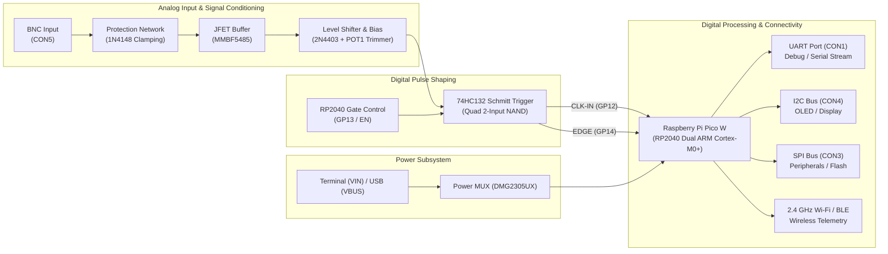
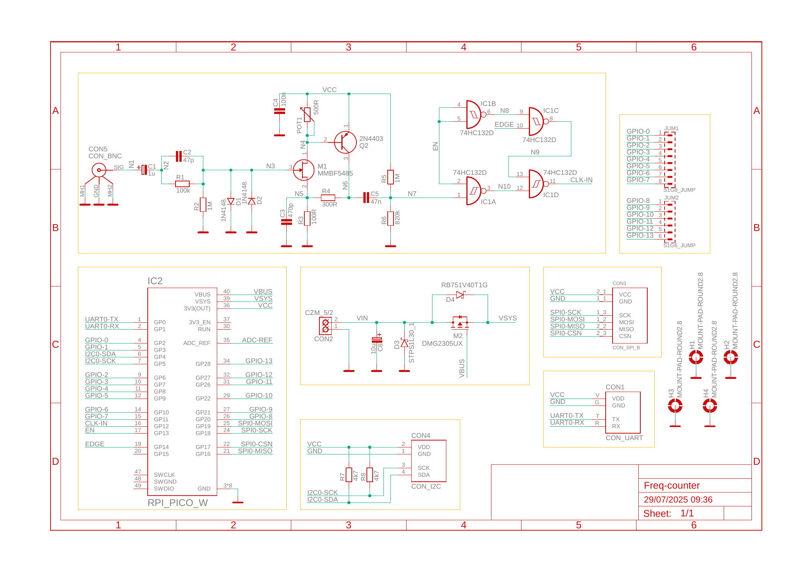

# High-Speed Frequency Counter & Pulse Shaper

> A high-speed digital frequency counter and pulse-shaping front-end module built around the Raspberry Pi Pico W (RP2040 MCU) and high-speed CMOS Schmitt triggers, equipped with a high-impedance JFET input buffer.

**Project Status:** `Completed / Hardware Design Ready` | **Main Technologies:** `Autodesk Eagle`, `Raspberry Pi Pico W (RP2040)`, `JFET / 74HC132`, `2-Layer PCB`

---

## 1. Overview & Key Features

The **Frequency Counter** module is designed for accurate measurement of signal frequency, period, and pulse intervals from RF and audio sources up to tens of megahertz. It features an active high-impedance analog front-end that conditions small or distorted analog waveforms into fast, clean logic edges suitable for hardware counting.

- **High-Impedance Front-End:** High-input-impedance JFET buffer (`MMBF5485`) minimizes capacitive and resistive loading on the signal source.
- **Overvoltage Protection:** Fast clamping diode network (`1N4148`, `RB751V40T1G`) protects the input stage against accidental overvoltage transients.
- **Adjustable Threshold / Sensitivity:** Multi-turn trimmer potentiometer (`POT1`, 500 Ω) adjusts the DC bias level across the level-shifting PNP transistor (`2N4403`) to optimize sensitivity for varying input amplitudes.
- **Fast Pulse Shaping:** High-speed quad NAND Schmitt trigger (`74HC132`) squares incoming signals into fast-rise digital pulses, with dedicated hardware gating / enable control.
- **RP2040 Dual-Core Processing:** Utilizes the Raspberry Pi Pico W for frequency counting via hardware PWM slice inputs / PIO state machines, enabling precise gated counting and wireless data transmission over Wi-Fi / BLE.
- **Flexible Power Management:** Automatic seamless power multiplexing between USB (`VBUS`) and an external terminal block (`VIN`, 5–12V) via a low-loss P-channel MOSFET (`DMG2305UX`) and Schottky diode (`STPS1L30`).
- **Rich Expansion Headers:** Dedicated connectors for `UART`, `I2C` (for OLED displays), `SPI`, and dual GPIO breakout headers (`JUM1`, `JUM2`).

---

## 2. Architecture & Operating Principle



### Signal Path Details
1. **Input Stage:** AC-coupled through `C1` into a high-impedance divider network (`R1`, `R2`) protected by back-to-back fast switching diodes `D1` and `D2`.
2. **Buffer & Level Shift:** JFET `M1` acts as a high-impedance voltage buffer, driving PNP transistor `Q2`. Trimmer `POT1` allows fine-tuning the operating point to capture both small AC signals (<100 mVpp) and rail-to-rail digital logic.
3. **Schmitt Triggering:** The conditioned signal is AC-coupled via `C5` into `IC1` (`74HC132`). The Schmitt trigger provides sharp hysteresis and eliminates false triggering on noisy or slow edges.
4. **RP2040 Capture:** The pulse stream is routed to `GP12` (`CLK-IN`) and `GP14` (`EDGE`). The RP2040 PWM counters or PIO state machines count input pulses over calibrated gate times generated by hardware timers.

---

## 3. Schematic & Hardware Previews

### Circuit Schematic


📄 [Open original high-resolution schematic drawing (PDF)](Freq-counter.pdf)

---

## 4. Project Structure

```text
.
├── Freq-counter.sch             # Autodesk Eagle schematic
├── Freq-counter.brd             # Autodesk Eagle 2-layer PCB layout (~77 x 57 mm)
├── Freq-counter.pdf             # Exported schematic reference drawing
├── eagle.epf                    # Eagle project configuration
├── Freq-counter_2025-07-29.zip  # Production package (CAM Gerber & Drill files, PnP assembly)
├── docs/
│   └── images/
│       └── schematic_p1.png     # Rendered high-resolution schematic preview
├── .gitignore                   # Ignore Eagle backup and temporary files
└── README.md                    # Project documentation
```

### Production Gerber & Drill Package (`Freq-counter_2025-07-29.zip`)
Contains standard RS-274X Gerber files and Excellon NC drill files ready for fabrication (JLCPCB, PCBWay, etc.):
- `copper_top.gbr`, `copper_bottom.gbr`
- `soldermask_top.gbr`, `soldermask_bottom.gbr`
- `silkscreen_top.gbr`, `silkscreen_bottom.gbr`
- `drill_1_16.xln`, `profile.gbr`
- `PnP_Freq-counter_front.txt`, `PnP_Freq-counter_back.txt` (Pick and Place)

---

## 5. Hardware Specifications & Pinout

### Technical Specifications
| Parameter | Value | Notes |
| :--- | :--- | :--- |
| **Microcontroller** | Raspberry Pi Pico W (RP2040) | Dual-core ARM Cortex-M0+ @ 133 MHz |
| **Input Connector** | BNC Female (`CON5`) | Standard 50 Ω / 1 MΩ scope probe compatible |
| **Input Coupling** | AC-coupled | `C1` (1 µF) capacitor |
| **Input Buffer** | MMBF5485 JFET | N-channel RF amplifier / high-Z buffer |
| **Pulse Shaper** | 74HC132 | Quad 2-input NAND Schmitt trigger |
| **Operating Voltage** | 5V DC (USB or Terminal) | Onboard 3.3V LDO on Pico W powers logic |
| **PCB Dimensions** | ~77.1 mm × 57.2 mm | 2 layers, FR4, 1.6 mm thickness |
| **Mounting** | 4 × M3 mounting holes (`H1`–`H4`) | Grounded / chassis connection |

### Raspberry Pi Pico Pin Mapping
| Pico Pin | Net Name | Function / Description |
| :--- | :--- | :--- |
| **GP12** | `CLK-IN` | High-speed pulse input from 74HC132 shaper |
| **GP14** | `EDGE` | Alternate edge detection input |
| **GP13** | `EN` | Hardware gate / enable line to 74HC132 |
| **GP0 / GP1** | `UART0-TX / RX` | Dedicated serial interface (`CON1`) |
| **GP4 / GP5** | `I2C0-SDA / SCK` | I2C bus with 4.7 kΩ pull-ups (`CON4`) |
| **GP16..GP19**| `SPI0-MISO/CS/SCK/MOSI` | High-speed SPI peripheral header (`CON3`) |
| **GP2..GP11** | `GPIO-0` .. `GPIO-7` | Breakout jumper header `JUM1` (8 pins) |
| **GP20..GP28**| `GPIO-8` .. `GPIO-13` | Breakout jumper header `JUM2` (6 pins) |

---

## 6. Getting Started & Fabrication

### PCB Ordering
Upload `Freq-counter_2025-07-29.zip` to any standard PCB manufacturer:
- **Layers:** 2
- **Dimensions:** 77.1 mm × 57.2 mm
- **Surface Finish:** HASL lead-free or ENIG (recommended for SMT components)
- **Solder Mask:** Green (or preferred color)
- **Copper Weight:** 1 oz (35 µm)

### Calibration & Tuning
1. Apply 5V power via the `CON2` screw terminal or USB port on the Raspberry Pi Pico.
2. Connect a function generator set to 1 MHz sine wave (1 Vpp) to the BNC input `CON5`.
3. Monitor the output of the Schmitt trigger on `GP12` (`CLK-IN`) with an oscilloscope.
4. Adjust trimmer potentiometer `POT1` until a symmetrical 50% duty cycle square wave is observed at `GP12`.
5. Verify that `GP13` (`EN`) set to LOW disables pulse transmission to the counter.

---

## 7. Related Projects

This board is part of a measurement and embedded instrumentation hardware suite:
- **[Oscilloscope Front-End](../Oscilloscope-front-end/):** Wideband analog front-end with programmable attenuator, AC/DC coupling, and high-speed ADC.
- **[rpi_pico](../../CVUT/projekty/rpi_pico/):** MicroPython firmware examples for Raspberry Pi Pico W (BLE, MQTT, wireless sensor communication).

---

## 8. Project Status & Next Steps

- [x] Schematic design and simulation of JFET buffer.
- [x] Complete 2-layer PCB layout with ground planes.
- [x] Generation of manufacturing Gerber and Drill outputs (`2025-07-29`).
- [ ] Firmware development: High-speed reciprocal frequency counter using RP2040 PIO state machines.
- [ ] 3D printable enclosure design.
